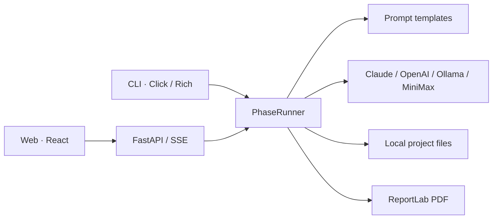

<!-- README_SYNC: source=working-tree; updated=2026-10-24 -->
<p align="center">
  简体中文 · <a href="./README_EN.md">English</a>
</p>

# murder-wizard

**面向剧本杀创作者的 AI 创作工作流：先做 2 人原型，再扩写为 6 人本，把剧本、信息矩阵和审计记录留在本地。**

[Star 收藏这个项目](https://github.com/Shaojie66/murder-mystery-ai-workflow) · 方便下次继续创作，也让更多创作者发现它。

[](https://github.com/Shaojie66/murder-mystery-ai-workflow/stargazers)
[](./pyproject.toml)
[](./pyproject.toml)
[](./LICENSE)
[](https://github.com/Shaojie66/murder-mystery-ai-workflow/issues)

感谢每一位 [Star 支持者](https://github.com/Shaojie66/murder-mystery-ai-workflow/stargazers)。

写出了故事梗概，接下来还要分配秘密、写角色本、补线索、核对时间线。最容易出问题的是：一个角色在某个时刻，说出了自己还不该知道的事。

murder-wizard 把这些工作拆成有文件产出的阶段。你提供创意、审阅结果、组织试玩；工具负责串起生成流程、记录角色认知，并辅助检查前后矛盾。

## 从一个原型开始

- **先验证核心冲突。** 原型按 2 人、3 个事件生成，确认方向后再用 `expand` 扩写，目标是 6 人、5–7 个事件。
- **把角色认知单独管理。** 信息矩阵记录角色对事件的认知状态，提供 Markdown 和结构化 JSON；Web 端可以逐格编辑。
- **剧本之外的材料一起准备。** 阶段 2 包含角色背景、阅读本、线索本、主持手册和结局，后续可生成测试指南与 PDF 草稿。
- **进度和调用有迹可查。** 阶段文件、会话状态、LLM 缓存与消耗日志保存在本地，CLI 与 Web 共用创作引擎。

项目处于 Alpha，主要面向中文剧本创作。生成结果需要人工审稿和真实试玩；AI 审计提供检查意见，不能保证剧本没有穿帮。

## 快速开始：生成第一份机制设计

需要 Python 3.10+、Git，以及可用的模型服务。以下命令面向 macOS / Linux，使用源码安装。

### 1. 安装 CLI

```bash
git clone https://github.com/Shaojie66/murder-mystery-ai-workflow.git
cd murder-mystery-ai-workflow
python3 -m venv .venv
source .venv/bin/activate
python -m pip install -e .
murder-wizard --help
```

### 2. 配置模型

这条入门路径使用 Claude。将两个占位值替换为你自己的 API key 和账户可用的模型 ID；显式指定模型，避免依赖代码中较旧的默认值。云端调用由对应服务商计费。

```bash
export LLM_PROVIDER=claude
export ANTHROPIC_API_KEY="YOUR_ANTHROPIC_API_KEY"
export CLAUDE_MODEL="YOUR_AVAILABLE_CLAUDE_MODEL"
```

### 3. 完成创意问卷

当前 CLI 首次初始化前需要先创建项目目录。向导中选择“原型模式”和“机制本”，填写题材、核心冲突、人物与结局标准，并选择让 AI 生成大纲。

```bash
mkdir -p "$HOME/.murder-wizard/projects/myproject"
murder-wizard init myproject
```

成功后，项目目录中应有 `brief.md`、`outline.md` 和 `session.json`。阶段 1 依赖已生成的大纲；如果大纲生成失败，先检查模型配置，再重新运行初始化。

### 4. 生成机制，再写角色

```bash
murder-wizard phase myproject 1
murder-wizard status myproject
```

检查 `~/.murder-wizard/projects/myproject/mechanism.md`，确认核心机制值得继续，再运行：

```bash
murder-wizard phase myproject 2
```

阶段 2 的主要产物是信息矩阵、角色背景、阅读本、线索本、主持手册和结局。可以直接打开 Markdown 文件审阅。

## 8 个阶段，各自产出什么

| 阶段 | 任务 | 主要文件 |
| --- | --- | --- |
| 1 | 验证概念、设计机制、检查平衡 | `mechanism.md`、`stage1_full_design.md` |
| 2 | 生成信息矩阵与剧本材料 | `information_matrix.md`、`background.md`、`characters.md`、`scripts_b.md`、`dm_manual.md`、`endings.md` |
| 3 | 准备视觉提示词 | `image-prompts.md` |
| 4 | 准备试玩、分析玩家反馈 | `test_guide.md`；分析后生成 `iteration_report.md` |
| 5 | 草拟成本、定价和渠道方案 | `commercial.md` |
| 6 | 导出印刷草稿与订单信息 | `script.pdf`、`materials/线索卡/线索卡.pdf`、`print_order.json` |
| 7 | 草拟各平台宣发文案 | `promo_content.md` |
| 8 | 草拟玩家社群运营方案 | `community_plan.md` |

原型试玩后可运行 `expand`。扩写完成后，复核线索本、主持手册和结局是否与新角色、事件保持一致，再继续后续阶段。

```bash
murder-wizard expand myproject
murder-wizard audit myproject
murder-wizard phase myproject 4
```

试玩需要你组织玩家。将实际反馈写入项目目录的 `feedback.md`，再用 CLI 分析：

```bash
murder-wizard phase myproject 4 --analyze
```

阶段 3 生成提示词，需要另外制作图像；阶段 5、7、8 生成文档，不会自动销售、发布或运营。

## 在浏览器里管理创作

Web 版提供项目工作台、阶段执行日志、Monaco 文件编辑器、信息矩阵、审计报告和消耗统计。它通过 SSE 向页面传送执行信息。

先完成上面的源码安装。在启动后端的终端中配置模型，然后从仓库根目录运行：

```bash
source .venv/bin/activate
python -m pip install -r murder_wizard_web/backend/requirements.txt
python -m uvicorn murder_wizard_web.backend.main:app --host 127.0.0.1 --port 8000
```

另开终端，从仓库根目录启动前端；需要 Node.js 和 npm：

```bash
cd murder_wizard_web/frontend
npm ci
npm run dev
```

打开 [本地工作台](http://localhost:5173)，后端接口文档在 [API 文档](http://localhost:8000/docs)。Docker 配置和更多接口说明见 [Web 文档](./murder_wizard_web/README.md)。

## 模型配置与数据去向

阶段执行通过 `LLM_PROVIDER` 选择适配器，未设置时默认使用 `claude`。

| 提供商 | 必需配置或前提 | 可选配置 |
| --- | --- | --- |
| `claude` | `ANTHROPIC_API_KEY` | `CLAUDE_MODEL` |
| `openai` | `OPENAI_API_KEY` | `OPENAI_MODEL` |
| `minimax` | `MINIMAX_API_KEY` | `MINIMAX_BASE_URL`、`MINIMAX_MODEL` |
| `ollama` | 已运行的 Ollama 服务与已下载的模型 | `OLLAMA_BASE_URL`、`OLLAMA_MODEL` |

Ollama 的本地默认地址为 `http://localhost:11434/v1`，默认模型名为 `llama3`；模型需要自行下载。**CLI 初始化向导生成大纲目前固定走 Claude**，其他提供商的阶段配置不会改变这一点。

作品、状态和日志写入 `~/.murder-wizard/projects/<name>/`。Web 设置保存在 `~/.murder-wizard/settings.json`，其中可能包含明文 API key。云端模型会收到用于生成的剧本上下文；使用本机 Ollama 且保持本地服务地址时，模型调用留在本机。

`cost.log` 记录调用的 token 数与估算费用。当前价格常量和货币显示口径尚未统一，请以服务商账单为准。

## 常用命令

| 命令 | 用途 |
| --- | --- |
| `murder-wizard init <name>` | 交互填写创意简报，可选择生成大纲 |
| `murder-wizard phase <name> <n>` | 执行阶段 1–8 |
| `murder-wizard status <name>` | 查看阶段状态和缺失产物 |
| `murder-wizard expand <name> [--yes]` | 将原型扩写为 6 人 × 7 事件；先在内存生成并校验候选，确认后才备份并覆盖，失败不改动作品；非交互运行必须加 `--yes`，失败退出码 1 |
| `murder-wizard audit <name>` | 只读审计 a/b 本、DM 手册、结局、矩阵与机制，保存 `audit_report.md`；“通过”仅表示模型未报告 P0；解析失败/缺材料为“未完成”；退出码 通过/已豁免 0、未通过 1、未完成 2；`.known_p0` 按 `AUD-xxxxxxxx` 键逐项豁免 |
| `murder-wizard resume <name>` | 加载状态、尝试从产物恢复并显示进度；之后手动运行所需阶段 |
| `murder-wizard cache <name>` | 查看 LLM 缓存统计 |

## 架构与扩展入口



| 位置 | 职责 |
| --- | --- |
| [murder_wizard/cli/](./murder_wizard/cli/) | 命令、创意向导和阶段执行器 |
| [murder_wizard/prompts/](./murder_wizard/prompts/) | 运行时加载的创作模板 |
| [murder_wizard/llm/](./murder_wizard/llm/) | 模型适配、缓存与并发控制 |
| [murder_wizard/wizard/](./murder_wizard/wizard/) | 状态、会话与结构化信息矩阵 |
| [murder_wizard/print/](./murder_wizard/print/) | PDF 草稿生成 |
| [murder_wizard_web/](./murder_wizard_web/) | FastAPI 后端与 React 前端 |
| [tests/](./tests/) | CLI、阶段执行、API、模型适配及状态测试 |

## 当前边界

- **类型入口还未统一。** Web 与模板层使用 `emotion`、`reasoning`、`fun`、`horror`、`mechanic` 五种类型；CLI 向导目前提供情感、机制和推理，其中推理标识为 `puzzle`，与模板层的 `reasoning` 不一致。CLI 入门建议先用机制本；类型和模式以向导里的选择为准。
- **图像、视频接口仍是存根。** 即梦和海螺适配器尚未完成，视觉阶段目前只产出提示词。
- **Pro 页面属于产品实验。** 订阅接口仍有存根，云存储、团队协作和付费权益不能视为已交付能力。CLI 已包含审计命令。
- **PDF 是待审阅的草稿。** 当前排版实现较基础，需检查中文字体、分页和线索卡内容，确认实际生成的文件后再打样。
- **Web 当前适合本地试用。** 身份与订阅接口含开发实现，部分统计保存在内存；公网、多用户生产使用仍需完善鉴权、隔离和持久化。

## 开发与贡献

完成源码安装后，安装测试工具并运行项目测试：

```bash
python -m pip install pytest httpx -r murder_wizard_web/backend/requirements.txt
python -m pytest tests/ -v
```

前端构建检查：

```bash
cd murder_wizard_web/frontend
npm run build
```

测试主要使用模拟模型响应，不能替代真实模型生成质量、玩家体验或印刷效果的验证。

- [贡献指南](./CONTRIBUTING.md)：开发约定与新增阶段的方法。
- [工作流文档](./docs/) · [可复用模板](./templates/) · [提示词资料库](./prompts/)。
- [变更记录](./CHANGELOG.md)：历史改动；当前功能以代码和入口为准。
- [产品探索计划](./discovery_plan.md)：尚需验证的产品方向。
- [MIT 许可证](./LICENSE)。

用得上就 [Star 收藏](https://github.com/Shaojie66/murder-mystery-ai-workflow)。遇到问题请提 [Issue](https://github.com/Shaojie66/murder-mystery-ai-workflow/issues)，附复现步骤和隐去密钥、私人剧本内容后的日志；代码贡献请参考贡献指南。
