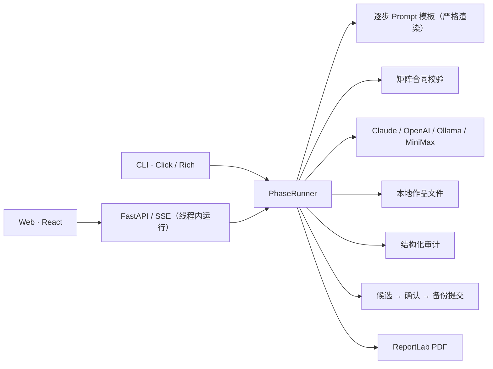

<!-- README_SYNC: source=working-tree; updated=2026-10-26 -->
<p align="center">
  简体中文 · <a href="./README_EN.md">English</a>
</p>

# murder-wizard

**剧本杀创作者的 AI 工作流：先做 2 人原型，再扩写成 6 人本；每个角色知道什么，用一张结构化矩阵管起来，改完还能审计。**

[⭐ Star 收藏这个项目](https://github.com/Shaojie66/murder-mystery-ai-workflow) · 方便下次继续创作，也让更多创作者发现它。

[](https://github.com/Shaojie66/murder-mystery-ai-workflow/stargazers)
[](./pyproject.toml)
[](./pyproject.toml)
[](./LICENSE)
[](https://github.com/Shaojie66/murder-mystery-ai-workflow/issues)

写剧本杀最怕的一件事：某个角色在某个时刻，说出了他当时还不该知道的事。故事梗概写完之后，分配秘密、写角色本、补线索、对时间线，每一步都在给这类穿帮制造机会。

murder-wizard 把这条路拆成有文件产出的阶段，并把"谁在什么时候知道什么"单独放进一张**角色 × 事件的信息矩阵**。你负责创意、审稿和组织试玩；工具负责串起生成流程、守住矩阵，并在你改完之后帮你检查前后矛盾。

<p align="center">
  
</p>

## 它和"通用 AI + 文档"有什么不同

- **矩阵是真相，不是附件。** 每个角色对每个事件的认知（知、疑、昧、否、误信、隐瞒）存成结构化 JSON。模型返回的矩阵缺角色、缺事件、引用不存在的证据、或者所有格子都是"否"，会被**直接拒绝**，不会被默默补齐后当成功。
- **失败不伪装成成功。** 非法输出不会写进作品，也不会留在缓存里被重试时原样重放；阶段 6 缺 PDF 就是失败；审计解析不了就是"未完成"，不是"0 个问题"。
- **扩写不动你的原文。** `expand` 先在内存里生成并校验完整的 6 人 × 7 事件候选，你确认后才备份并覆盖；原两位角色的剧本逐字保留，只在后面追加他们在新事件里的视角。
- **审计只读，改动由你决定。** 审计读取 a 本、b 本、主持手册、结局、矩阵和机制，给出带定位的结构化问题；修复建议只会在交互终端里、你选中之后才写入，写入前先备份。
- **本地优先。** 作品、状态、缓存和消耗日志都在 `~/.murder-wizard/projects/<name>/`，CLI 与 Web 共用同一个创作引擎。

<p align="center">
  
</p>

项目处于 Alpha，面向本地、单用户使用，主要为中文剧本创作。生成结果需要人工审稿和真实试玩；AI 审计提供检查意见，**"通过"只表示模型没有报告 P0，不等于没有穿帮**。

## 快速开始：生成第一份机制设计

需要 Python 3.10+、Git，以及可用的模型服务。以下命令面向 macOS / Linux，使用源码安装。

### 1. 安装 CLI

```bash
git clone https://github.com/Shaojie66/murder-mystery-ai-workflow.git
cd murder-mystery-ai-workflow
python3 -m venv .venv
source .venv/bin/activate
python -m pip install -e .
murder-wizard --help
```

### 2. 配置模型

这条入门路径使用 Claude。把两个占位值换成你自己的 API key 和账户可用的模型 ID；显式指定模型，避免依赖代码里较旧的默认值。云端调用由对应服务商计费。

```bash
export LLM_PROVIDER=claude
export ANTHROPIC_API_KEY="YOUR_ANTHROPIC_API_KEY"
export CLAUDE_MODEL="YOUR_AVAILABLE_CLAUDE_MODEL"
```

### 3. 完成创意问卷

当前 CLI 首次初始化前需要先创建项目目录。向导里选"原型模式"和"机制本"，填写题材、核心冲突、人物与结局标准，并选择让 AI 生成大纲。

```bash
mkdir -p "$HOME/.murder-wizard/projects/myproject"
murder-wizard init myproject
```

成功后，项目目录里应有 `brief.md`、`outline.md` 和 `session.json`。阶段 1 依赖已生成的大纲；大纲生成失败时，先检查模型配置，再重新运行初始化。

### 4. 生成机制，再写角色

```bash
murder-wizard phase myproject 1
murder-wizard status myproject
```

检查 `~/.murder-wizard/projects/myproject/mechanism.md`，确认核心机制值得继续，再运行：

```bash
murder-wizard phase myproject 2
```

阶段 2 依次生成信息矩阵、角色背景、阅读本（a 本）、线索本（b 本）、主持手册和结局，每一步只带本步需要的输入。信息矩阵不合法时阶段 2 会在第一步就失败，不会继续往下写。

## 8 个阶段，各自产出什么

| 阶段 | 任务 | 主要文件 |
| --- | --- | --- |
| 1 | 验证概念、设计机制、检查平衡 | `mechanism.md`、`stage1_full_design.md` |
| 2 | 生成信息矩阵与剧本材料 | `state/character_matrix.json`、`information_matrix.md`、`background.md`、`characters.md`、`scripts_b.md`、`dm_manual.md`、`endings.md` |
| 3 | 准备视觉提示词 | `image-prompts.md` |
| 4 | 准备试玩、分析玩家反馈 | `test_guide.md`；分析后生成 `iteration_report.md` |
| 5 | 草拟成本、定价和渠道方案 | `commercial.md` |
| 6 | 导出印刷草稿与订单信息 | `script.pdf`、`materials/线索卡/线索卡.pdf`、`print_order.json` |
| 7 | 草拟各平台宣发文案 | `promo_content.md` |
| 8 | 草拟玩家社群运营方案 | `community_plan.md` |

## 原型 → 6 人本 → 审计

原型试玩过后运行 `expand`，扩成 6 人、7 个事件（E1–E3 为原型事件，E4–E7 只续写，晚于 E3）：

```bash
murder-wizard expand myproject
murder-wizard audit myproject
```

`expand` 默认交互确认，非交互运行必须加 `--yes`。它的行为：

- 固定 19 步顺序生成，全部在内存里校验；任何一步失败，作品原样保留，已通过的步骤命中缓存，重跑只重新调用失败的那一步。
- 在 `characters.md`、`background.md`、`scripts_b.md` 的原文**之后追加**内容；整份重新生成 `information_matrix.md`、`dm_manual.md`、`endings.md` 和 `state/character_matrix.json`。
- 覆盖前备份 8 个文件（含 `session.json`）为 `<文件>.proto.<时间戳>`，写入失败会从备份恢复；工具不会自动删除备份。
- 成功只表示"通过结构校验"，尚未审计；扩写后建议立刻运行 `audit`，并自己读一遍新角色与原剧本是否衔接。
- 前提：阶段 2 产物齐全，且 `state/character_matrix.json` 是合法的 2 人 × 3 事件矩阵。没有合法矩阵的旧作品会被明确拒绝，不会自动转换。

<p align="center">
  
</p>

`audit` 的行为：

- 只读。三轮审计（矩阵逐格、机制一致性、结局合理性）要求模型返回结构化 JSON；解析失败、被截断或缺材料时结论是**未完成**，而不是通过。
- 结论分四种：通过（模型未报告 P0）、已豁免、未通过、未完成。退出码依次为 0、0、1、2。
- 可以在项目目录的 `.known_p0` 里按报告打印的 `AUD-xxxxxxxx` 逐项豁免 P0；不再按数量抵扣。
- 有可用补丁时，只会在交互终端里列出，由你选择应用；写入前备份为 `<文件>.pre_audit.<时间戳>`，失败回滚。

试玩需要你自己组织玩家。把实际反馈写进项目目录的 `feedback.md`，再分析：

```bash
murder-wizard phase myproject 4 --analyze
```

阶段 3 只生成提示词，图像需要另外制作；阶段 5、7、8 生成文档，不会自动销售、发布或运营。

## 在浏览器里管理创作

Web 版提供项目工作台、阶段执行日志、Monaco 文件编辑器、信息矩阵编辑、审计报告和消耗统计。

先完成上面的源码安装。在启动后端的终端里配置模型，然后从仓库根目录运行：

```bash
source .venv/bin/activate
python -m pip install -r murder_wizard_web/backend/requirements.txt
python -m uvicorn murder_wizard_web.backend.main:app --host 127.0.0.1 --port 8000
```

另开终端，从仓库根目录启动前端；需要 Node.js 和 npm：

```bash
cd murder_wizard_web/frontend
npm ci
npm run dev
```

打开 [本地工作台](http://localhost:5173)，接口文档在 [API 文档](http://localhost:8000/docs)。Docker 配置和更多接口说明见 [Web 文档](./murder_wizard_web/README.md)。

任务合同（以事件为准，而不是 HTTP 状态）：

- 同一作品同一时刻只允许一个写入任务，重复运行返回 409。
- 事件的 `data` 都是 JSON；每次运行以 `end` 事件收尾，`status` 为 `success`、`failed` 或 `cancelled`。HTTP 200 不代表业务成功。
- 取消只是"请求取消"：正在进行的模型调用无法被打断，作品保持占用直到任务真正结束。
- Web 的扩写会先弹出确认框，并以 `accept_overwrite=true` 调用；不带这个参数的 `/expand` 请求会在调用模型之前失败。

## 模型配置与数据去向

阶段执行通过 `LLM_PROVIDER` 选择适配器，未设置时默认使用 `claude`。

| 提供商 | 必需配置或前提 | 可选配置 |
| --- | --- | --- |
| `claude` | `ANTHROPIC_API_KEY` | `CLAUDE_MODEL` |
| `openai` | `OPENAI_API_KEY` | `OPENAI_MODEL` |
| `minimax` | `MINIMAX_API_KEY` | `MINIMAX_BASE_URL`、`MINIMAX_MODEL` |
| `ollama` | 已运行的 Ollama 服务与已下载的模型 | `OLLAMA_BASE_URL`、`OLLAMA_MODEL` |

Ollama 的本地默认地址是 `http://localhost:11434/v1`，默认模型名 `llama3`；模型需要自行下载。**CLI 初始化向导生成大纲目前固定走 Claude**，其他提供商的阶段配置不会改变这一点。

作品、状态和日志写入 `~/.murder-wizard/projects/<name>/`。Web 设置保存在 `~/.murder-wizard/settings.json`，其中可能包含明文 API key。**本地存储不等于离线运行**：使用云端模型时，用于生成和审计的剧本上下文会发送给模型服务商（审计一次会把全部材料发送三轮）；只有使用本机 Ollama 且保持本地服务地址时，模型调用才留在本机。

`cost.log` 记录调用的 token 数与估算费用；缓存命中记为 0。价格常量和货币显示口径尚未统一，请以服务商账单为准。

## 常用命令

| 命令 | 用途 |
| --- | --- |
| `murder-wizard init <name>` | 交互填写创意简报，可选择生成大纲；`--type` 为 emotion、reasoning、fun、horror、mechanic 之一，`--prototype/--full` 选择模式 |
| `murder-wizard phase <name> <n> [--analyze]` | 执行阶段 1–8；阶段失败退出码为 1 |
| `murder-wizard status <name>` | 查看阶段状态和缺失产物 |
| `murder-wizard expand <name> [--yes]` | 把原型扩写为 6 人 × 7 事件；失败或放弃退出码为 1 |
| `murder-wizard audit <name>` | 只读审计并保存 `audit_report.md`；退出码 0 通过/已豁免、1 未通过、2 未完成；`--force` 已弃用，不改变结论 |
| `murder-wizard resume <name>` | 加载状态；`session.json` 损坏时从产物恢复并写回磁盘 |
| `murder-wizard cache <name>` | 查看或清空 LLM 缓存 |

## 架构与扩展入口



| 位置 | 职责 |
| --- | --- |
| [murder_wizard/cli/](./murder_wizard/cli/) | 命令、创意向导、阶段执行器、扩写编排 |
| [murder_wizard/prompts/](./murder_wizard/prompts/) | 运行时加载的创作、审计、扩写模板；缺必填输入在调用模型前失败 |
| [murder_wizard/llm/](./murder_wizard/llm/) | 模型适配、缓存（被拒绝的响应会被逐出）与并发控制 |
| [murder_wizard/wizard/](./murder_wizard/wizard/) | 状态与会话、矩阵合同、审计（`audit.py`）、扩写逻辑与多文件提交 |
| [murder_wizard/print/](./murder_wizard/print/) | PDF 草稿生成 |
| [murder_wizard_web/](./murder_wizard_web/) | FastAPI 后端与 React 前端 |
| [tests/](./tests/) | CLI、阶段执行、审计、扩写、API、模型适配及状态测试 |

## 当前边界

- **输出上限可能截断长材料。** 适配器单次输出上限是 4096 tokens，主持手册和结局在真实模型上可能被截断；目前只用"末段标题加最小正文"检测，截断恰好落在末段中间时检测不到。真正的修复在模型适配层，尚未做。
- **旧作品不会被自动转换。** 没有合法 `state/character_matrix.json` 的作品，审计判"未完成"，`expand` 直接拒绝。
- **扩写比以前严格。** 固定 6 人 × 7 事件，不再支持 5–7 个事件或在原事件链中间插入事件；Web 一键扩写需要显式确认。
- **审计不是真值。** 空问题列表只代表模型没报告；每个任务的耗时和费用都不低，本地小模型可能长期"未完成"。
- **图像、视频接口仍是存根。** 即梦和海螺适配器尚未完成，视觉阶段目前只产出提示词。
- **Pro 页面属于产品实验。** 订阅接口仍有存根，云存储、团队协作和付费权益不能视为已交付能力。
- **PDF 是待审阅的草稿。** 排版实现较基础，需检查中文字体、分页和线索卡内容，确认实际生成的文件后再打样。
- **Web 仅适合本地单用户。** 身份与订阅接口含开发实现，部分统计保存在内存；公网、多用户生产使用仍需真实身份、隔离和持久化。
- **没有已验证的效果数据。** 目前没有真人试玩或审计准确率的统计，本文不宣称速度提升或"不穿帮"。

## 开发与贡献

完成源码安装后，安装测试工具并运行项目测试：

```bash
python -m pip install pytest httpx -r murder_wizard_web/backend/requirements.txt
PYTHONDONTWRITEBYTECODE=1 python -m pytest tests/ -q -p no:cacheprovider
```

前端构建检查：

```bash
cd murder_wizard_web/frontend
npm run build
```

测试使用临时目录和模拟模型，不读取你的真实作品，也不能替代真实模型生成质量、玩家体验或印刷效果的验证。

- [贡献指南](./CONTRIBUTING.md)：开发约定与新增阶段的方法。
- [本轮可靠性方案](./docs/reliability-mvp-plan.md) · [任务清单](./TODOS.md)：范围、验收与未完成项。
- [工作流文档](./docs/) · [可复用模板](./templates/) · [提示词资料库](./prompts/)。
- [变更记录](./CHANGELOG.md)：历史改动；当前功能以代码和入口为准。
- [MIT 许可证](./LICENSE)。

用得上就 [Star 收藏](https://github.com/Shaojie66/murder-mystery-ai-workflow)。遇到问题请提 [Issue](https://github.com/Shaojie66/murder-mystery-ai-workflow/issues)，附复现步骤和隐去密钥、私人剧本内容后的日志；代码贡献请参考贡献指南。
