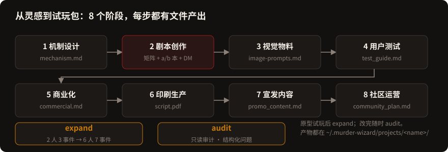
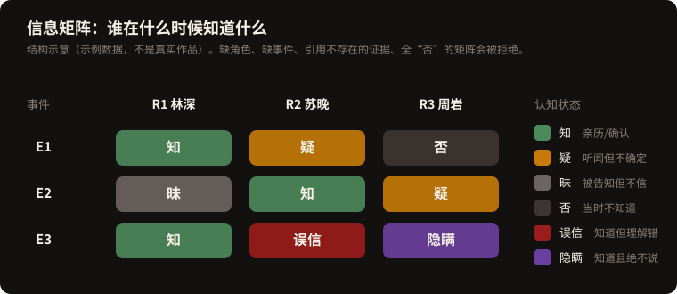
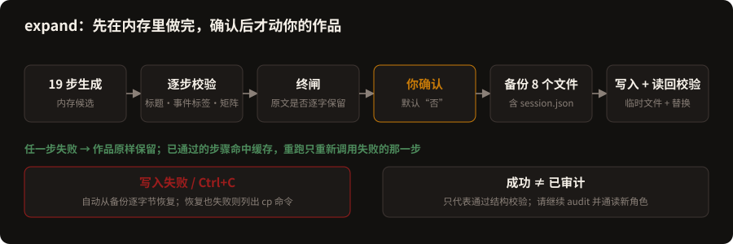
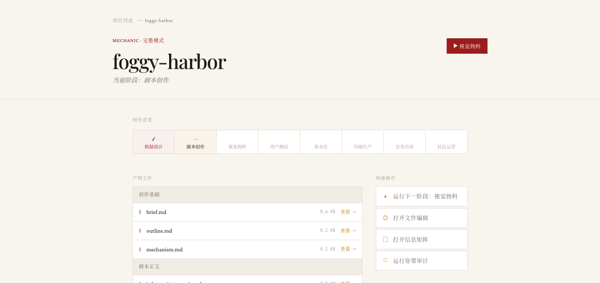
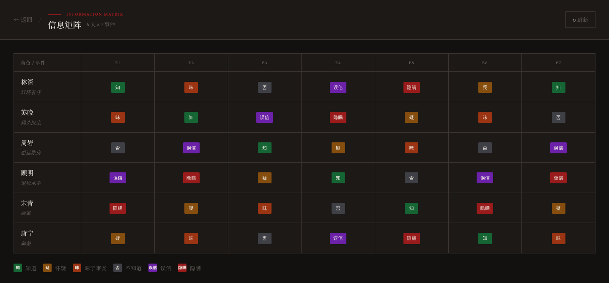
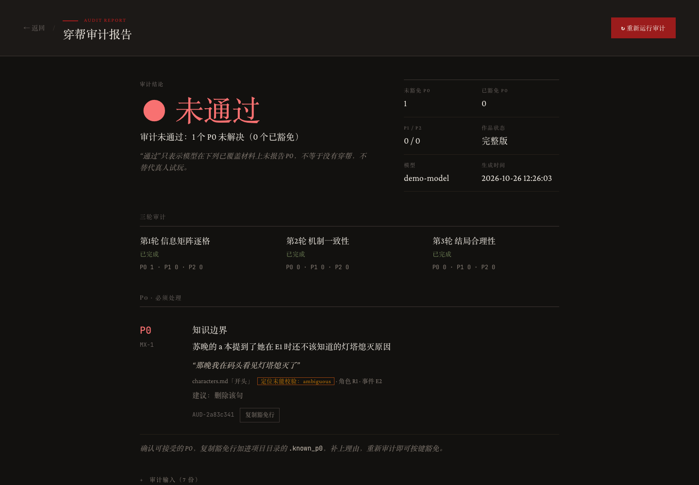
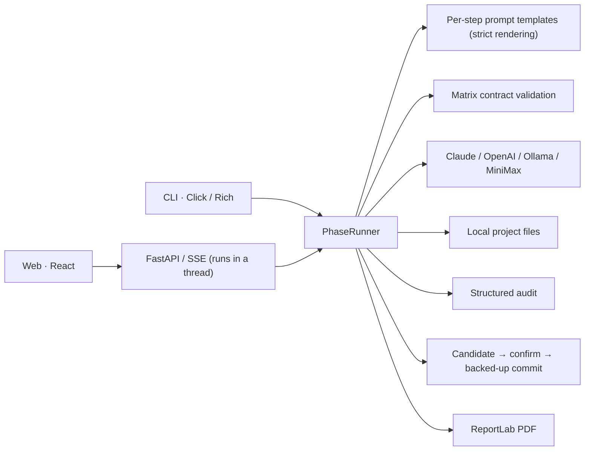

<!-- README_SYNC: source=working-tree; updated=2026-10-26 -->
<p align="center">
  <a href="./README.md">简体中文</a> · English
</p>

# murder-wizard

**An AI workflow for murder-mystery (剧本杀) authors: prototype with 2 characters, expand to a 6-character game, and keep "who knows what" in one structured matrix that you can audit after every edit.**

[⭐ Star this project](https://github.com/Shaojie66/murder-mystery-ai-workflow) · so you can find it again, and so other authors can discover it.

[](https://github.com/Shaojie66/murder-mystery-ai-workflow/stargazers)
[](./pyproject.toml)
[](./pyproject.toml)
[](./LICENSE)
[](https://github.com/Shaojie66/murder-mystery-ai-workflow/issues)

The failure every murder-mystery author dreads: a character says something, at a moment when they could not yet know it. Once the synopsis is done, every step after it (assigning secrets, writing character books, adding clues, checking the timeline) is another chance for that mistake.

murder-wizard splits the work into stages that each produce files, and keeps "who knows what, and when" in its own **character × event information matrix**. You bring the idea, review the output and run the playtests. The tool drives the generation pipeline, guards the matrix, and helps you catch contradictions after you edit.

> Chinese is the primary language of this project: prompts, templates and generated material are in Chinese. This README is an English rewrite for developers, not a line-by-line translation.

<p align="center">
  
</p>

## How this differs from "a general chat model plus documents"

- **The matrix is the source of truth.** Each character's state for each event (know, suspect, doubt, unaware, misbelieve, conceal) is stored as structured JSON. A model reply with a missing character, a missing event, a dangling evidence reference, or an all-"unaware" matrix is **rejected outright**, never padded and reported as success.
- **Failures do not pose as success.** Invalid output is neither written to your work nor left in the cache to be replayed on retry. Stage 6 fails if a required PDF is missing. An audit that cannot be parsed is "incomplete", not "zero issues".
- **Expand never touches your original text.** `expand` generates and validates the full 6-character × 7-event candidate in memory, then backs up and overwrites only after you confirm. The original two characters' scripts are kept byte for byte, and only their views of the new events are appended.
- **Audits are read-only; edits are your call.** The audit reads the a-scripts, b-scripts, DM manual, endings, matrix and mechanism, and reports structured issues with locations. Suggested fixes are written only from an interactive terminal after you pick them, with a backup first.
- **Local first.** Work, state, cache and the cost log live in `~/.murder-wizard/projects/<name>/`. The CLI and the web app share one engine.

<p align="center">
  
</p>

The project is Alpha, for local single-user use. Generated material needs human review and real playtests. **A "passed" audit only means the model reported no P0; it does not mean there are no continuity errors.**

## Quick start: generate your first mechanism design

You need Python 3.10+, Git and a model provider. The commands below target macOS / Linux and install from source.

### 1. Install the CLI

```bash
git clone https://github.com/Shaojie66/murder-mystery-ai-workflow.git
cd murder-mystery-ai-workflow
python3 -m venv .venv
source .venv/bin/activate
python -m pip install -e .
murder-wizard --help
```

### 2. Configure the model

This starter path uses Claude. Replace the two placeholders with your own API key and a model ID your account can use. Set the model explicitly rather than relying on the older default in the code. Cloud calls are billed by the provider.

```bash
export LLM_PROVIDER=claude
export ANTHROPIC_API_KEY="YOUR_ANTHROPIC_API_KEY"
export CLAUDE_MODEL="YOUR_AVAILABLE_CLAUDE_MODEL"
```

### 3. Fill in the creative questionnaire

The CLI currently expects the project directory to exist before the first `init`. In the wizard choose "prototype mode" and "mechanic", fill in the setting, core conflict, characters and ending criteria, and let the AI generate the outline.

```bash
mkdir -p "$HOME/.murder-wizard/projects/myproject"
murder-wizard init myproject
```

On success the project directory should contain `brief.md`, `outline.md` and `session.json`. Stage 1 depends on the outline; if outline generation fails, check the model configuration and rerun `init`.

### 4. Generate the mechanism, then the characters

```bash
murder-wizard phase myproject 1
murder-wizard status myproject
```

Review `~/.murder-wizard/projects/myproject/mechanism.md`. If the core mechanism is worth pursuing, run:

```bash
murder-wizard phase myproject 2
```

Stage 2 generates, in order, the information matrix, character backgrounds, a-scripts (reading books), b-scripts (clue books), the DM manual and the endings. Each step receives only the inputs it needs. If the matrix is invalid, Stage 2 fails at the first step and writes nothing further.

## Eight stages and what each produces

| Stage | Task | Main files |
| --- | --- | --- |
| 1 | Validate the concept, design the mechanism, check balance | `mechanism.md`, `stage1_full_design.md` |
| 2 | Information matrix and script material | `state/character_matrix.json`, `information_matrix.md`, `background.md`, `characters.md`, `scripts_b.md`, `dm_manual.md`, `endings.md` |
| 3 | Visual prompts | `image-prompts.md` |
| 4 | Playtest guide; analysis of player feedback | `test_guide.md`; `iteration_report.md` after analysis |
| 5 | Draft costs, pricing and channels | `commercial.md` |
| 6 | Print drafts and order info | `script.pdf`, `materials/线索卡/线索卡.pdf`, `print_order.json` |
| 7 | Draft promotion copy per platform | `promo_content.md` |
| 8 | Draft a player-community plan | `community_plan.md` |

## Prototype → 6-character game → audit

After playtesting the prototype, run `expand` to grow it to 6 characters and 7 events (E1–E3 are the prototype events; E4–E7 only continue the story, after E3):

```bash
murder-wizard expand myproject
murder-wizard audit myproject
```

`expand` asks for confirmation by default; add `--yes` when running non-interactively. What it does:

- 19 sequential steps, all validated in memory. If any step fails, your work stays as it was; steps that passed hit the cache, so a rerun re-calls only the failed one.
- **Appends** to `characters.md`, `background.md` and `scripts_b.md` after the original text, and regenerates `information_matrix.md`, `dm_manual.md`, `endings.md` and `state/character_matrix.json` as whole files.
- Before overwriting, it backs up 8 files (including `session.json`) as `<file>.proto.<timestamp>`, and restores from them if a write fails. The tool never deletes backups.
- Success only means "passed structural checks", not "audited". Run `audit` right after, and read for yourself how the new characters connect to your original script.
- Precondition: all Stage 2 files exist and `state/character_matrix.json` is a valid 2-character × 3-event matrix. Older projects without a valid matrix are refused, not converted automatically.

<p align="center">
  
</p>

What `audit` does:

- Read-only. Three rounds (matrix cell by cell, mechanism consistency, ending soundness) require structured JSON from the model. Unparseable, truncated or missing-material runs end as **incomplete**, never as passed.
- Four outcomes: passed (model reported no P0), waived, blocked, incomplete. Exit codes 0, 0, 1, 2 respectively.
- Waive a P0 per issue in the project's `.known_p0` using the `AUD-xxxxxxxx` key printed in the report. Count-based waivers are gone.
- Applicable patches are listed only in an interactive terminal and applied only if you select them. Each file is backed up as `<file>.pre_audit.<timestamp>` first, and rolled back on failure.

Playtests are yours to organise. Put real feedback in `feedback.md` in the project directory, then analyse it:

```bash
murder-wizard phase myproject 4 --analyze
```

Stage 3 only produces prompts, so images must be made elsewhere. Stages 5, 7 and 8 produce documents; they do not sell, publish or run anything for you.

## Manage a project in the browser

The web app provides a project workbench, stage run logs, a Monaco file editor, a matrix editor, audit reports and cost statistics.

Complete the source install above first. Configure the model in the terminal that starts the backend, then from the repository root:

```bash
source .venv/bin/activate
python -m pip install -r murder_wizard_web/backend/requirements.txt
python -m uvicorn murder_wizard_web.backend.main:app --host 127.0.0.1 --port 8000
```

In another terminal, start the frontend from the repository root (Node.js and npm required):

```bash
cd murder_wizard_web/frontend
npm ci
npm run dev
```

Open the [local workbench](http://localhost:5173); the API docs are at [API docs](http://localhost:8000/docs). Docker setup and more API details are in the [web docs](./murder_wizard_web/README.md).

### Interface preview

These three images come from the project's real web interface, using a demo project called `foggy-harbor`. The project content is demo text. The audit report is rendered by the real audit pipeline, but the model reply behind it is scripted and does not represent any real model's audit result.

| Project workbench | Information matrix editor |
| --- | --- |
|  |  |

<p align="center">
  
</p>

Task contract (events decide the outcome, not the HTTP status):

- At most one write task per project at a time; a duplicate run gets 409.
- Event `data` is always JSON, and every run ends with an `end` event whose `status` is `success`, `failed` or `cancelled`. HTTP 200 does not mean business success.
- Cancel is only a request: an in-flight model call cannot be interrupted, and the project stays locked until the task really ends.
- Expand in the web app asks for confirmation and calls the API with `accept_overwrite=true`; an `/expand` request without it fails before any model call.

## Model configuration and where your data goes

Stages pick an adapter through `LLM_PROVIDER`; the default is `claude`.

| Provider | Required | Optional |
| --- | --- | --- |
| `claude` | `ANTHROPIC_API_KEY` | `CLAUDE_MODEL` |
| `openai` | `OPENAI_API_KEY` | `OPENAI_MODEL` |
| `minimax` | `MINIMAX_API_KEY` | `MINIMAX_BASE_URL`, `MINIMAX_MODEL` |
| `ollama` | a running Ollama server and a downloaded model | `OLLAMA_BASE_URL`, `OLLAMA_MODEL` |

Ollama defaults to `http://localhost:11434/v1` and the model name `llama3`; you must download the model yourself. **The init wizard currently always uses Claude to generate the outline**, regardless of the provider you set for stages.

Work, state and logs are written to `~/.murder-wizard/projects/<name>/`. Web settings are stored in `~/.murder-wizard/settings.json` and may contain a plaintext API key. **Local storage is not offline operation**: with a cloud model, the script context used for generation and auditing is sent to the provider (one audit sends all materials across three rounds). Only a local Ollama server on its local address keeps model calls on your machine.

`cost.log` records token counts and estimated cost; cache hits count as 0. Price constants and currency display are not yet unified, so rely on the provider's bill.

## Commands

| Command | Purpose |
| --- | --- |
| `murder-wizard init <name>` | Fill in the creative brief interactively, optionally generate an outline; `--type` is one of emotion, reasoning, fun, horror, mechanic; `--prototype/--full` picks the mode |
| `murder-wizard phase <name> <n> [--analyze]` | Run stage 1–8; a failed stage exits 1 |
| `murder-wizard status <name>` | Show stage status and missing artifacts |
| `murder-wizard expand <name> [--yes]` | Expand a prototype to 6 characters × 7 events; failure or declining exits 1 |
| `murder-wizard audit <name>` | Read-only audit, saves `audit_report.md`; exit 0 passed/waived, 1 blocked, 2 incomplete; `--force` is deprecated and does not change the verdict |
| `murder-wizard resume <name>` | Load state; if `session.json` is damaged, rebuild from artifacts and write it back |
| `murder-wizard cache <name>` | Show or clear the LLM cache |

## Architecture and extension points



| Location | Role |
| --- | --- |
| [murder_wizard/cli/](./murder_wizard/cli/) | Commands, creative wizard, stage runner, expand orchestration |
| [murder_wizard/prompts/](./murder_wizard/prompts/) | Templates loaded at runtime for writing, audit and expand; a missing required input fails before the model is called |
| [murder_wizard/llm/](./murder_wizard/llm/) | Model adapters, cache (rejected responses are evicted) and concurrency control |
| [murder_wizard/wizard/](./murder_wizard/wizard/) | State and sessions, matrix contract, audit (`audit.py`), expand logic and multi-file commit |
| [murder_wizard/print/](./murder_wizard/print/) | PDF draft generation |
| [murder_wizard_web/](./murder_wizard_web/) | FastAPI backend and React frontend |
| [tests/](./tests/) | CLI, stage runner, audit, expand, API, model adapter and state tests |

## Current limits

- **The output cap can truncate long material.** The adapter's per-call limit is 4096 tokens, so the DM manual and endings may be cut off with real models. Detection only checks the last required heading plus a minimum of text after it, so a cut in the middle of the last section is missed. The real fix belongs in the model adapter and is not done.
- **Older projects are not converted automatically.** Without a valid `state/character_matrix.json`, an audit is "incomplete" and `expand` refuses.
- **Expand is stricter than before.** It is fixed at 6 characters × 7 events; 5–7 events and inserting events into the middle of the original timeline are no longer supported. Web expand needs explicit confirmation.
- **An audit is not ground truth.** An empty issue list only means the model reported nothing; each run is slow and not free, and small local models may stay "incomplete".
- **Image and video adapters are stubs.** The Jimeng and Hailuo adapters are unfinished; the visual stage only produces prompts.
- **The Pro pages are product experiments.** Subscription endpoints are stubs; cloud storage, team collaboration and paid entitlements are not delivered.
- **PDFs are drafts for review.** The layout is basic; check Chinese fonts, pagination and clue cards in the actual files before proofing.
- **The web app is for local single-user use.** The token endpoint signs a JWT for any `user_id`, the settings endpoints have no authentication, and so do the signup and statistics endpoints; public or multi-user use needs real identity, isolation and persistence, see the [boundary notes](./docs/local-only-boundary.md) (in Chinese).
- **There is no validated outcome data.** There are no real playtest or audit-accuracy numbers yet, so this README claims no speed-up and no "no continuity errors".

## Development and contributing

After the source install, install the test tools and run the tests:

```bash
python -m pip install pytest httpx -r murder_wizard_web/backend/requirements.txt
PYTHONDONTWRITEBYTECODE=1 python -m pytest tests/ -q -p no:cacheprovider
```

Frontend build check:

```bash
cd murder_wizard_web/frontend
npm run build
```

Tests use temporary directories and mocked model responses; they never read your real projects and cannot replace validation of real model quality, player experience or print results.

- [Contributing guide](./CONTRIBUTING.md): conventions and how to add a stage.
- [Reliability plan for this iteration](./docs/reliability-mvp-plan.md) · [Task list](./TODOS.md): scope, acceptance and open items.
- [Workflow docs](./docs/) · [Reusable templates](./templates/) · [Prompt library](./prompts/).
- [Changelog](./CHANGELOG.md): history; current behaviour follows the code and entry points.
- [License](./LICENSE): PolyForm Noncommercial 1.0.0. Source-available; free to use for permitted non-commercial purposes (personal, learning, education, research and other non-commercial use); **commercial use requires prior authorization**, including commercial integration, paid services, SaaS, internal business processes of a company, or commercial redistribution. This is not an OSI-defined open-source license.

If it is useful to you, [Star it](https://github.com/Shaojie66/murder-mystery-ai-workflow). For problems, open an [Issue](https://github.com/Shaojie66/murder-mystery-ai-workflow/issues) with reproduction steps and logs with keys and private script content removed; for code contributions see the contributing guide.
