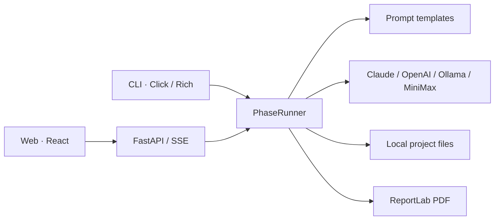

<!-- README_SYNC: source=working-tree; updated=2026-10-24 -->
<p align="center">
  <a href="./README.md">简体中文</a> · English
</p>

# murder-wizard

**An AI-assisted workflow for murder mystery authors: start with a two-player prototype, expand toward six players, and keep scripts, knowledge matrices, and audit records locally.**

[Star the project](https://github.com/Shaojie66/murder-mystery-ai-workflow) to find it again and help other authors discover it.

[](https://github.com/Shaojie66/murder-mystery-ai-workflow/stargazers)
[](./pyproject.toml)
[](./pyproject.toml)
[](./LICENSE)
[](https://github.com/Shaojie66/murder-mystery-ai-workflow/issues)

Thanks to everyone who has [starred the repository](https://github.com/Shaojie66/murder-mystery-ai-workflow/stargazers).

A premise is only the beginning. You still need to distribute secrets, write character booklets, supply clues, and reconcile the timeline. One recurring continuity problem: a character refers to something they could not yet have known.

murder-wizard organizes that work into stages with editable file outputs. You supply the creative brief, review the writing, and run playtests. The tool connects generation steps, records character knowledge, and assists with consistency checks.

## Start small, then expand

- **Test the central conflict first.** Prototype generation targets two players and three events. Use `expand` once the direction works, targeting six players and five to seven events.
- **Track who knows what.** A knowledge matrix records each character's awareness of events in Markdown and structured JSON. The Web editor lets you edit individual cells.
- **Prepare the supporting materials.** Stage 2 covers backgrounds, reading booklets, clue booklets, a host manual, and endings. Later stages produce playtest guides and draft PDFs.
- **Keep an inspectable working record.** Stage files, session state, LLM caches, and usage logs live locally. The CLI and Web interface share the same generation engine.

This is an Alpha project built primarily for Chinese-language murder mystery writing. Outputs need editorial review and real playtests. AI audits offer findings; they cannot guarantee a plot free of continuity errors.

## Quick start: generate a mechanism design

You need Python 3.10+, Git, and access to a model service. These instructions install from source on macOS / Linux.

### 1. Install the CLI

```bash
git clone https://github.com/Shaojie66/murder-mystery-ai-workflow.git
cd murder-mystery-ai-workflow
python3 -m venv .venv
source .venv/bin/activate
python -m pip install -e .
murder-wizard --help
```

### 2. Configure a model

This walkthrough uses Claude. Replace both placeholder values with your own API key and a model ID available to your account. Set the model explicitly because the built-in default is old. Cloud calls are billed by the model provider.

```bash
export LLM_PROVIDER=claude
export ANTHROPIC_API_KEY="YOUR_ANTHROPIC_API_KEY"
export CLAUDE_MODEL="YOUR_AVAILABLE_CLAUDE_MODEL"
```

### 3. Write your creative brief

The current CLI requires you to create the project directory before the first initialization. In the Chinese-language wizard, choose prototype mode (原型模式) and the mechanics-focused type (机制本), answer the creative questions, and accept AI outline generation.

```bash
mkdir -p "$HOME/.murder-wizard/projects/myproject"
murder-wizard init myproject
```

A successful initialization creates `brief.md`, `outline.md`, and `session.json` in the project directory. Stage 1 requires a generated outline. If outline generation fails, check the model configuration and rerun initialization first.

### 4. Design the mechanism, then write the characters

```bash
murder-wizard phase myproject 1
murder-wizard status myproject
```

Review `~/.murder-wizard/projects/myproject/mechanism.md`. If the central mechanism is worth developing, continue with:

```bash
murder-wizard phase myproject 2
```

Stage 2 produces the knowledge matrix, backgrounds, reading booklets, clue booklets, host manual, and endings. Open the Markdown files to review them.

## Eight stages and their outputs

| Stage | Task | Main files |
| --- | --- | --- |
| 1 | Validate the concept, design mechanics, and review balance | `mechanism.md`, `stage1_full_design.md` |
| 2 | Generate the knowledge matrix and script materials | `information_matrix.md`, `background.md`, `characters.md`, `scripts_b.md`, `dm_manual.md`, `endings.md` |
| 3 | Prepare visual prompts | `image-prompts.md` |
| 4 | Plan playtests and analyze player feedback | `test_guide.md`; analysis produces `iteration_report.md` |
| 5 | Draft costs, pricing, and distribution plans | `commercial.md` |
| 6 | Export draft print files and order information | `script.pdf`, `materials/线索卡/线索卡.pdf`, `print_order.json` |
| 7 | Draft promotional copy for different platforms | `promo_content.md` |
| 8 | Draft a player community plan | `community_plan.md` |

After playtesting the prototype, use `expand`. Review whether the clue booklets, host manual, and endings still agree with the expanded cast and events before continuing.

```bash
murder-wizard expand myproject
murder-wizard audit myproject
murder-wizard phase myproject 4
```

You organize the actual playtest. Save real player feedback as `feedback.md` in the project directory, then analyze it through the CLI:

```bash
murder-wizard phase myproject 4 --analyze
```

Stage 3 produces prompts; image production is a separate step. Stages 5, 7, and 8 generate documents, without automatically selling, publishing, or running a community.

## Work in the browser

The Web interface provides a project workbench, execution logs, a Monaco file editor, a knowledge matrix editor, audit reports, and usage statistics. Execution messages reach the page through SSE.

Complete the source installation above first. Configure the model in the terminal that will run the backend, then run these commands from the repository root:

```bash
source .venv/bin/activate
python -m pip install -r murder_wizard_web/backend/requirements.txt
python -m uvicorn murder_wizard_web.backend.main:app --host 127.0.0.1 --port 8000
```

In a second terminal, start the frontend from the repository root. Node.js and npm are required:

```bash
cd murder_wizard_web/frontend
npm ci
npm run dev
```

Open the [local workbench](http://localhost:5173). The backend exposes [API documentation](http://localhost:8000/docs). See the [Web documentation](./murder_wizard_web/README.md) for Docker configuration and additional endpoints.

## Model configuration and data

Stage execution selects its adapter through `LLM_PROVIDER`, defaulting to `claude` when unset.

| Provider | Required configuration or prerequisite | Optional configuration |
| --- | --- | --- |
| `claude` | `ANTHROPIC_API_KEY` | `CLAUDE_MODEL` |
| `openai` | `OPENAI_API_KEY` | `OPENAI_MODEL` |
| `minimax` | `MINIMAX_API_KEY` | `MINIMAX_BASE_URL`, `MINIMAX_MODEL` |
| `ollama` | A running Ollama service with a downloaded model | `OLLAMA_BASE_URL`, `OLLAMA_MODEL` |

Ollama defaults to `http://localhost:11434/v1` and model name `llama3`; download the model separately. **Outline generation in the CLI initialization wizard currently always uses Claude.** Choosing another provider for stage execution does not change that behavior.

Project files, state, and logs are written to `~/.murder-wizard/projects/<name>/`. Web settings live in `~/.murder-wizard/settings.json` and may contain plaintext API keys. Cloud providers receive the script context used in generation. Model calls stay on your machine when using a local Ollama instance with a local service address.

`cost.log` records token usage and estimated costs. Pricing constants and displayed currencies are not yet consistent; use your provider's bill as the authoritative cost record.

## CLI reference

| Command | Purpose |
| --- | --- |
| `murder-wizard init <name>` | Fill in a creative brief interactively, with optional outline generation |
| `murder-wizard phase <name> <n>` | Execute stage 1–8 |
| `murder-wizard status <name>` | Inspect stage state and missing artifacts |
| `murder-wizard expand <name> [--yes]` | Expand a prototype to 6 characters × 7 events; the candidate is generated and validated in memory, files are backed up and overwritten only after confirmation, failures leave the work untouched; `--yes` is required when non-interactive; failure exits 1 |
| `murder-wizard audit <name>` | Read-only audit of a/b scripts, DM manual, endings, matrix and mechanism; saves `audit_report.md`; "passed" only means the model reported no P0; parse failures or missing materials are "incomplete"; exit code 0 passed/waived, 1 blocked, 2 incomplete; waive P0s per issue via `AUD-xxxxxxxx` keys in `.known_p0` |
| `murder-wizard resume <name>` | Load state, attempt recovery from artifacts, and show progress; run the desired stage manually afterward |
| `murder-wizard cache <name>` | Inspect LLM cache statistics |

## Architecture and extension points



| Location | Responsibility |
| --- | --- |
| [murder_wizard/cli/](./murder_wizard/cli/) | Commands, creative questionnaire, and stage execution |
| [murder_wizard/prompts/](./murder_wizard/prompts/) | Templates loaded at runtime |
| [murder_wizard/llm/](./murder_wizard/llm/) | Model adapters, caching, and concurrency control |
| [murder_wizard/wizard/](./murder_wizard/wizard/) | State, sessions, and structured knowledge matrices |
| [murder_wizard/print/](./murder_wizard/print/) | Draft PDF generation |
| [murder_wizard_web/](./murder_wizard_web/) | FastAPI backend and React frontend |
| [tests/](./tests/) | CLI, stage execution, API, model adapter, and state tests |

## Current limitations

- **Story-type entry points differ.** The Web interface and template layer use `emotion`, `reasoning`, `fun`, `horror`, and `mechanic`. The CLI wizard currently offers emotion, mechanics, and deduction, with deduction labeled `puzzle` rather than the template layer's `reasoning`. Start with mechanics in the CLI. The wizard's selections determine the final type and mode.
- **Image and video integrations are stubs.** The Jimeng and Hailuo adapters are unfinished; the visual stage currently generates prompts only.
- **Pro screens are product experiments.** Subscription endpoints still include stubs. Cloud storage, team collaboration, and paid entitlements are not delivered capabilities. The CLI already includes the audit command.
- **PDFs are review drafts.** Layout support is basic. Check Chinese fonts, page breaks, clue card content, and the files actually generated before ordering proofs.
- **The Web interface is intended for local evaluation.** Identity and subscription endpoints include development implementations, and some analytics live in memory. Public, multi-user production use needs further authentication, isolation, and persistence work.

## Development and contributions

After installing from source, install the test tools and run the project suite:

```bash
python -m pip install pytest httpx -r murder_wizard_web/backend/requirements.txt
python -m pytest tests/ -v
```

Check the frontend build:

```bash
cd murder_wizard_web/frontend
npm run build
```

Tests primarily use mocked model responses. They do not validate real model writing quality, player experience, or printed output.

- [Contributing guide](./CONTRIBUTING.md): development conventions and how to add a stage.
- [Workflow documentation](./docs/) · [Reusable templates](./templates/) · [Prompt reference library](./prompts/).
- [Changelog](./CHANGELOG.md): historical changes; current behavior follows the code and entry points.
- [Product discovery plan](./discovery_plan.md): directions that still need validation.
- [MIT License](./LICENSE).

If this fits your workflow, [star the repository](https://github.com/Shaojie66/murder-mystery-ai-workflow). Report problems through [Issues](https://github.com/Shaojie66/murder-mystery-ai-workflow/issues), including reproduction steps and logs with keys and private script content removed. See the contributing guide for code contributions.
